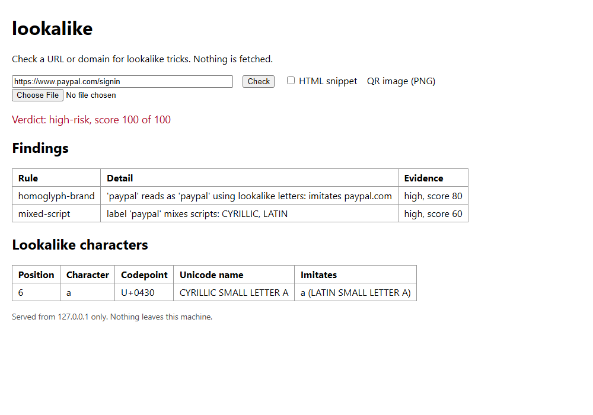

# lookalike

Check a link, a domain, an HTML snippet or a QR code screenshot for the usual
"this is not the site it claims to be" tricks before you click. Everything runs
locally and nothing is ever fetched. Standard library only; written and tested on Python 3.14.

It looks for:

- homoglyphs: Cyrillic/Greek/Armenian letters standing in for Latin ones, mixed scripts in one label, invisible characters, bad punycode, fullwidth tricks
- typosquats against a brand list: one edit away (keyboard neighbour, bit flip, transposition, missing/doubled letter, hyphen), `1`/`l`, `0`/`o`, `rn`/`m` swaps, the brand name stuck into the domain or a subdomain (`paypal.com.evil.example`)
- `user@host` and backslash tricks, raw and obfuscated IP hosts (`http://3232235777/`), percent-encoded hosts
- shorteners, abused TLDs, very long or machine-looking hosts
- link text that shows one site while the `href` goes to another (HTML snippets)

## Run it

    pip install -e .

    lookalike check https://paypa1.com/login
    lookalike check "https://www.paypal.com@evil.example/"
    lookalike check --html mail.html
    lookalike check --qr screenshot.png
    lookalike check --stdin --format json < links.txt

Exit codes: 0 nothing found, 1 suspicious, 2 high-risk, 3 bad input or usage
(a malformed target only gives 3 if nothing else was suspicious).
"Clean" means no lookalike signal, not that the site is safe.

The brand list is built in (43 well-known domains). Add your own:

    lookalike brands add mycompany.com
    lookalike brands list
    lookalike check --brands extra.txt somelink.example

`brands add` writes `%APPDATA%\lookalike\brands.txt` (or `$LOOKALIKE_HOME/brands.txt`).

## Watching your own domain

    lookalike generate example.com
    lookalike generate example.com --resolve --registered-only

`generate` lists permutations of a domain you own (omissions, transposed and
neighbour keys, bit flips, homoglyphs with their punycode, hyphens, other TLDs).
That part is offline. `--resolve` is opt-in: it sends those names to
cloudflare-dns.com over DNS-over-HTTPS (capped by `--max-queries`, default 300)
to see which exist. A name that resolves is only a lead, not proof of abuse.

## GUI

    lookalike gui            # prints the URL and opens your default browser
    lookalike gui --no-open --port 8765
    lookalike gui --browser "C:\Program Files\LibreWolf\librewolf.exe"

`BROWSER` works too. It serves on 127.0.0.1 only, rejects other Host and Origin
headers, and loads nothing from outside. It is one plain page: type a URL or
domain, press Check, and you get the verdict and score, a table of findings and a
table of the lookalike characters in the host (position, code point, Unicode name,
and the ASCII letter each imitates). Open `/#some.domain` to prefill a check. The
"Evidence" column of the findings table is just the severity and score the rule
contributed; the matching text is in the detail.

## QR images

The reader is about 300 lines of Python and is deliberately narrow: PNG files
only, a clean unrotated code (a screenshot, not a photo), versions 1-6, byte,
numeric and alphanumeric modes. It checks the Reed-Solomon syndromes but does
not correct errors; a damaged code is refused rather than guessed at. Longer
URLs (version 7 and up), photos, rotated or inverted codes need a real decoder:
decode them elsewhere and pass the text to `check`.

I tested it against codes made by a small QR writer in `tests/`, not against
codes from third-party generators, so interoperability with every encoder is
unproven.

## Known gaps

- The confusables table is hand-written (48 characters). It covers the common Latin lookalikes, not all of Unicode's confusables data.
- The public-suffix handling is a short built-in list of two-part suffixes, not the real PSL, so exotic suffixes can be mis-split.
- Brand matching only knows the domains you give it; a brand not on the list is never flagged.
- Scores are hand-tuned heuristics, and short brand names are only matched for homoglyphs and subdomain tricks to avoid noise.

## Development

    python -m venv .venv
    .venv\Scripts\pip install -e .[dev]
    .venv\Scripts\pytest
    .venv\Scripts\ruff check .
